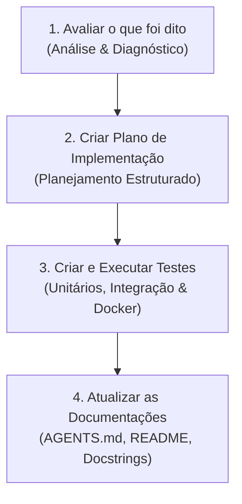

# AGENTS.md — Guia do Sistema Bancada STI

Este documento centraliza as diretrizes arquiteturais, o ciclo de desenvolvimento de engenharia de software e as instruções operacionais para agentes autônomos de programação que colaboram no repositório **automacao-chamados-sti**.

---

## 🎯 1. Visão Geral e Missão

O **Sistema Bancada STI** é uma plataforma integrada desenvolvida para o setor de Tecnologia da Informação do **Ministério Público do Estado de Mato Grosso do Sul (MPMS)**. 

### Principais Capacidades:
- **Esteira de Chamados (ETR/Orquestrador):** Extração, consolidação e triagem automatizada de chamados de TI originados nos sistemas **OTRS** e **CitSmart**.
- **Classificação Inteligente por IA:** Motor de Machine Learning com pré-processamento em lote (spaCy), enriquecimento de texto com metadados e modelo campeão (*LinearSVC*) para atribuição instantânea de TAGs técnicas, além de rotinas mensais agendadas para recalibração via *GridSearchCV*.
- **Gestão de Bancada & Patrimônio:** Controle de equipamentos em manutenção, preparação de computadores para doação/baixa, redistribuição regional e cálculo de rotas de entrega.
- **Módulos Corporativos:** Gestão de plantões de TI, lista de ramais e unidades administrativas do MPMS, controle de garantias de hardware, chamados de fiscalização e links/FAQs técnicos.
- **Automação Remota:** Execução segura de scripts de auditoria e manutenção de estações de trabalho via PowerShell.

---

## 🔄 2. Ciclo de Engenharia Obrigatório por Prompt / Tarefa

Todos os agentes autônomos devem **obrigatoriamente** seguir o seguinte fluxo de 4 etapas para qualquer requisição ou melhoria solicitada:



### 1️⃣ Avaliar o que foi dito (Análise & Diagnóstico)
- Ler atentamente os arquivos envolvidos antes de aplicar qualquer modificação.
- Analisar dependências cruzadas, impactos em tabelas do banco de dados (PostgreSQL/SQLite) e contratos de interface.
- Verificar se a funcionalidade já possui testes existentes em `tests/` ou se exige novas validações.

### 2️⃣ Criar Plano de Implementação (Planejamento Estruturado)
- Estruturar em tópicos objetivos as etapas que serão realizadas.
- Preservar a compatibilidade reversa com o banco de dados híbrido e os serviços de background.
- Garantir que comentários técnicos e docstrings pré-existentes não relacionados à alteração sejam mantidos íntegros.

### 3️⃣ Criar e Executar Testes Unitários e de Integridade (Validação Rigorosa)
- Toda nova funcionalidade, refatoração ou correção de bug **deve vir acompanhada de testes automatizados** em `tests/unit/`, `tests/integration/` ou `tests/components/`.
- **Ambiente de Execução:** Os testes DEVEM ser executados prioritariamente dentro do contêiner Docker ativo:
  ```bash
  docker exec bancada_streamlit_app python tests/run_all.py
  # Ou para uma suíte específica:
  docker exec bancada_streamlit_app python -m unittest tests/unit/test_ml_champion_pipeline.py
  ```
- **Critério de Aceite:** 100% de sucesso na suíte de testes (0 falhas, 0 erros).

### 4️⃣ Atualizar as Documentações (Sincronização & Persistência)
- Refletir imediatamente nos arquivos de documentação (`AGENTS.md`, `README.md`, docstrings de módulos e `.env.example`) quaisquer adições de variáveis de ambiente, novas tabelas, parâmetros de algoritmos ou rotas.
- Manter o resumo de contexto e diretrizes arquiteturais atualizados.

---

## 🏛️ 3. Arquitetura do Sistema e Estrutura de Diretórios

```
automacao-chamados-sti/
├── 00-iniciar.cmd              # Inicializador rápido para ambiente Windows
├── 00-iniciar.sh               # Inicializador para Linux / WSL (Docker Compose + QR Code)
├── AGENTS.md                   # Diretrizes universais para agentes autônomos (este arquivo)
├── Dockerfile                  # Container Python 3.11-slim com Playwright, spaCy e deps
├── docker-compose.yml          # Orquestração do app Streamlit (8501) e PostgreSQL (5432)
├── dashboard.py                # Ponto de entrada do dashboard web Streamlit
├── init.py                     # Inicializador Python com banner, QR code e checagem de portas
├── orquestrador.py             # Pipeline ETL de chamados (Scraper OTRS/CitSmart -> IA -> BD)
├── requirements.txt            # Dependências Python gerenciadas
│
├── Docs/                       # 📚 Central Unificada de Documentação Técnica
│   ├── README.md               # Índice mestre navegável com hyperlinks
│   ├── arquitetura/            # Decisões de engenharia, modelagem DB, IA, segurança e PowerShell
│   ├── guias/                  # Manuais operacionais, deploy Docker, esteira, bancada e utilitários
│   ├── testes/                 # Documentação da suíte de testes e mocks universais
│   └── issues/                 # Backlog oficial, marcos entregues e roadmap do projeto
│
├── data/                       # 📦 Diretório centralizado de dados (volume Docker ./data:/app/data)
│   ├── 01 - Dados Brutos/      # Coletas brutas (OTRS, CitSmart, OXE, SCCM, Unidades)
│   ├── 02 - Dados tratados/    # Bases intermediárias higienizadas e normalizadas
│   ├── 03 - Dados prontos/     # Bases consolidadas e classificadas pela IA
│   ├── calendario.ics          # Calendário consolidado gerado automaticamente
│   └── chamados.db             # Opcional: criado sob demanda apenas em fallback SQLite (DB_TYPE=sqlite)
│
├── src/
│   ├── config.py               # Configurações, logging, resolução de planilhas e ensure_project_directories()
│   ├── crypto_utils.py         # Criptografia simétrica Fernet com fallback transparente
│   ├── tag_classifier.py       # Pipeline de IA: spaCy batch, modelo campeão LinearSVC e GridSearchCV
│   │
│   ├── database/               # Camada DAO híbrida (PostgreSQL padrão / SQLite fallback)
│   │   ├── bootstrap.py        # Inicialização automática e idempotente de todas as tabelas/índices/seeds
│   │   ├── connection.py       # Gerenciador de conexão com pool (get_db_connection)
│   │   ├── tickets_db.py       # Persistência e consultas de chamados
│   │   ├── cron_db.py          # Gestão de agendamentos de tarefas do Cron Daemon
│   │   ├── ad_db.py            # Cache de dados do Active Directory
│   │   ├── garantia_db.py      # Gestão de garantias de hardware
│   │   ├── ramais_db.py        # Cadastro e busca rápida de ramais
│   │   ├── sccm_db.py          # Dados integrados de inventário SCCM/MECM
│   │   └── ...                 # Demais módulos DAO por domínio
│   │
│   ├── scrapers/               # Motores de coleta web unificados (Requests + Playwright)
│   │   ├── otrs_scraper_fast.py# Coletor HTTP veloz via requests + BeautifulSoup
│   │   ├── citsmart_scraper.py # Coletor automatizado via Playwright Chromium
│   │   ├── sharepoint_downloader.py # Downloader híbrido ultrarrápido (requests em cache + Playwright)
│   │   └── ...                 # Scrapers de plantões, ramais, unidades, OXE, PaperCut e FAQs
│   │
│   ├── services/
│   │   └── cron_scheduler.py   # Daemon de agendamento em segundo plano (tarefas periódicas)
│   │
│   ├── tabs/                   # Abas modulares da interface Streamlit
│   │   ├── chamados.py         # Visualização, filtros e triagem de chamados
│   │   ├── configuracoes.py    # Configurações do sistema, credenciais, cron e métricas da IA
│   │   ├── redistribuicao.py   # Gestão de máquinas, baixas, doações e termos
│   │   ├── sccm.py             # Consulta de estações e software via SCCM
│   │   ├── plantoes.py         # Escala de sobreaviso e plantão de TI
│   │   └── ...                 # Demais abas funcionais
│   │
│   └── scripts_powershell/     # Automações remotas (Analisador, Perfis, Limpeza, etc.)
│
├── tests/                      # Suíte de testes automatizados
│   ├── run_all.py              # Runner mestre de validação de 100% dos testes
│   ├── test_helpers.py         # Mocks universais seguros para isolamento de testes
│   ├── unit/                   # Testes unitários (banco, IA, criptografia, senhas)
│   ├── integration/            # Testes de integração (rotas, calendários ICS, env)
│   ├── components/             # Testes de componentes Streamlit
│   ├── scripts/                # Testes de integridade de scripts PowerShell
│   └── services/               # Testes dos workers de serviço (Cron Daemon)
│
└── util/
    ├── migracoes/              # Scripts de migração de schema e dados (SQLite -> PostgreSQL)
    └── comparar_scrapers.py    # Benchmark comparativo de performance entre scrapers
```

---

## ⚙️ 4. Diretrizes Técnicas e Padrões de Código

### 🐳 Execução em Contêiner Docker
- **Isolamento de Ambiente:** O ambiente de produção e desenvolvimento roda 100% em containers Docker (`bancada_streamlit_app` e `bancada_postgres_db`).
- Toda execução de comandos de teste, scripts ou migrações deve ser executada prioritariamente via:
  ```bash
  docker exec bancada_streamlit_app python <caminho_do_script>
  ```

### 🧠 Inteligência Artificial & Pipeline de Classificação (`src/tag_classifier.py`)
- **Pré-processamento spaCy em Lote:** Utilizar `clean_texts_batch` com `nlp.pipe(batch_size=256, n_process=1)` e pipes de parser/ner desativados (`disable=["parser", "ner"]`) para máxima velocidade.
- **Enriquecimento de Features:** A função `compose_ticket_text` deve unificar Título, Unidade, Descrição e Comentários para garantir assertividade na predição.
- **Modelo Campeão:** O classificador de rotina deve instanciar diretamente a arquitetura vencedora do GridSearchCV:
  ```python
  Pipeline([
      ('tfidf', TfidfVectorizer(ngram_range=(1, 2), max_df=0.7, min_df=1)),
      ('clf', LinearSVC(C=1.0, class_weight='balanced', random_state=42, dual=False))
  ])
  ```
- **Recalibração Profunda:** O `GridSearchCV` exaustivo deve ser acionado apenas via tarefa periódica mensal (`retrain_ia_gridsearch`) no Cron Daemon ou pelo botão manual de sintonia na aba de Configurações (`--tune`).

### 📊 Resolução Unificada de Planilhas e URLs do SharePoint (`src/config.py`)
- **Cascata de Prioridade Obrigatória:** Toda consulta a caminhos ou links de planilhas (Doações, Fiscalização, Garantias, Férias, Viagens, Escala Matutina e Chamados) DEVE utilizar o helper `get_spreadsheet_setting(key, default)`:
  1. **Prioridade 1:** Configurações salvas no Banco de Dados (`system_settings`).
  2. **Prioridade 2 (Fallback):** Arquivo `.env` (montado em tempo real no Docker via volume).
  3. **Prioridade 3:** Valor padrão (*default*) especificado no código.
- **Tratamento Seguro de URLs vs Caminhos Locais:** NUNCA concatenar `USER_HOME / valor` diretamente caso o valor seja uma URL remota (`http://` ou `https://`). Utilize sempre `resolve_spreadsheet_path(key, default_cache_name)` para evitar caminhos corrompidos (`/root/https:/...`), direcionando URLs remotas para o cache local padronizado em `uploads/`.

### 🔒 Segurança, Hardening & Cofre de Credenciais (`src/crypto_utils.py`, `src/auth.py`)
- **Nenhum Segredo Rastreável:** Nenhum token, senha ou chave privada deve ser commitado no repositório. O `.gitignore` bloqueia `.env`, `.secret.key`, `*.key`, `*.pem`, `cred_admin*.xml` e `sccm_inventory.json`.
- **Arquitetura Fail-Closed:** Serviços externos, conexões de banco e APIs (Evolution API, SCCM, PostgreSQL) NUNCA devem iniciar com senhas fracas padrão ou chaves vazias. Na ausência de variáveis obrigatórias, o sistema deve abortar ou recusar a operação imediatamente.
- **Isolamento de Portas:** Portas internas e de banco no `docker-compose.yml` (PostgreSQL 5432, Evolution API 8080) devem ser mantidas restritas a `127.0.0.1`.
- **Sanitização de Inputs & Whitelist Regex:** Hostnames, IPs e parâmetros passados a scripts remotos devem ser validados via regex (`^[a-zA-Z0-9][a-zA-Z0-9.\-_]{0,252}$`). Credenciais nunca são passadas na linha de comando, e sim via `env`. Filtros LDAP devem utilizar `escape_filter_chars` e caminhos de arquivos devem barrar Path Traversal (`..`).
- **Rate Limiting & Anti-Brute-Force:** O módulo de autenticação implementa bloqueio temporário (lockout) automático após 5 tentativas consecutivas incorretas (5 minutos de espera).
- **Permissões 0600:** Arquivos sensíveis (`.env`, `.secret.key`, XMLs de credenciais) recebem permissão restrita `0600` (`-rw-------`).
- Em caso de troca de ambiente ou chave mestra ausente, a função `decrypt_value()` nunca deve lançar exceção fatal nem retornar o token corrompido como senha válida: deve registrar aviso nos logs e retornar string vazia `""`, permitindo o fallback transparente para o keyring do SO ou variáveis de ambiente.

### 💻 Interface Streamlit
- Para elementos de layout que ocupam a largura completa da tela, utilize o parâmetro moderno `width='stretch'` (evitando o parâmetro obsoleto `use_container_width=True` em componentes mais novos).
- Renderização de componentes HTML personalizados deve ser feita através de `st.components.v1.html(...)`.

### 🪟 Scripts PowerShell (`src/scripts_powershell/`)
- Todos os arquivos `.ps1` DEVEM ser salvos com **UTF-8 com BOM** (`utf-8-sig`). A ausência de BOM pode causar falhas de interpretação de acentos pelo console do Windows PowerShell legados (versões 5.1).
- Todos os arquivos Python e de configuração devem usar quebra de linha no padrão Unix (`LF`).

---

## 🚀 5. Comandos de Referência Rápida

| Objetivo | Comando |
| :--- | :--- |
| **Rodar Toda a Suíte de Testes** | `docker exec bancada_streamlit_app python tests/run_all.py` |
| **Rodar Testes de Segurança & Hardening** | `docker exec bancada_streamlit_app python -m unittest tests/unit/test_security_hardening.py` |
| **Rodar Testes da IA Campeã** | `docker exec bancada_streamlit_app python -m unittest tests/unit/test_ml_champion_pipeline.py` |
| **Rodar o Orquestrador de Chamados** | `docker exec bancada_streamlit_app python orquestrador.py` |
| **Recalibrar IA (GridSearchCV Completo)** | `docker exec bancada_streamlit_app python src/tag_classifier.py --tune` |
| **Migrar SQLite para PostgreSQL** | `docker exec -e POSTGRES_HOST=db bancada_streamlit_app python util/migracoes/migrar_sqlite_para_postgres.py` |
| **Verificar Status dos Contêineres** | `docker compose ps` |
| **Visualizar Logs do Streamlit** | `docker compose logs -f app` |

