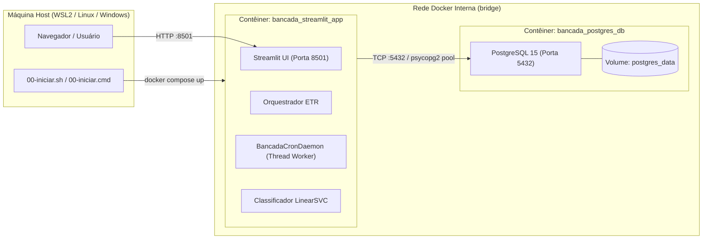

# Sistema Bancada STI — Dossiê de Contexto Global da Arquitetura

> **Data de Atualização:** Novembro de 2026  
> **Objetivo:** Ponto de restauração, alinhamento técnico e entendimento global do ecossistema do Sistema Bancada STI (MPMS). Concentra a arquitetura da esteira ETR, containerização, banco de dados híbrido, motor de Machine Learning, segurança e automações remotas.
>
> 📌 *O mapa de navegação e índice mestre de documentação encontra-se em [Docs/README.md](../README.md).*

---

## 1. Visão Geral do Sistema

O **Sistema Bancada STI** é uma plataforma integrada de engenharia de software desenvolvida para o setor de Tecnologia da Informação do **Ministério Público do Estado de Mato Grosso do Sul (MPMS)**.

- **Missão:** Centralizar, automatizar e acelerar o ciclo operacional do suporte de TI, eliminando retrabalho manual na triagem de chamados, controle físico de equipamentos em manutenção/doação, escalas corporativas e diagnósticos remotos de estações de trabalho.
- **Princípios Arquiteturais:**
  1. **Velocidade e Eficiência:** Processamento em lote (batch), conexões HTTP diretas sem sobrecarga de navegadores desnecessários e paralelismo em CPU.
  2. **Resiliência e Tolerância a Falhas:** Fallbacks transparentes de banco de dados (PostgreSQL com contingência SQLite) e criptografia com suporte a troca de ambiente.
  3. **Isolamento e Reprodutibilidade:** Execução 100% conteinerizada via Docker Compose (sem dependência de ambientes virtuais `venv` na máquina host).

---

## 2. Topologia de Infraestrutura & Contêineres

O ecossistema opera através do **Docker Compose** orquestrando dois serviços principais em rede interna isolada:

### Portas e Serviços:

| Serviço | Contêiner Docker | Porta Host | Porta Interna | Descrição |
| :--- | :--- | :--- | :--- | :--- |
| **Bancada App** | `bancada_streamlit_app` | `8501` | `8501` | Dashboard interativo Streamlit, pipeline ETR e Cron Daemon |
| **PostgreSQL** | `bancada_postgres_db` | `5432` | `5432` | Banco relacional corporativo oficial com dados de chamados, inventário e escalas |

---

## 3. Principais Subsistemas e Fluxos de Dados

### 3.1 Esteira de Chamados de TI (ETR / Orquestrador)
O script `orquestrador.py` executa o pipeline de Extração, Transformação e Carga:
1. **Coleta OTRS Rápida (`src/scrapers/otrs_scraper_fast.py`):** Autenticação por sessão HTTP nativa via `requests.Session`, parsing do HTML das filas com `BeautifulSoup` e extração paralela dos artigos/notas live com `ThreadPoolExecutor`.
2. **Coleta CitSmart (`src/scrapers/citsmart_scraper.py`):** Navegação headless automatizada via Playwright/Chromium para extração de tickets da plataforma corporativa.
3. **Pré-processamento (`src/cleaners/` e `src/tag_classifier.py`):** Tratamento de texto, remoção de caracteres de controle, enriquecimento de metadados e lematização em lote via spaCy (`clean_texts_batch`).
4. **Classificação Inteligente:** Atribuição instantânea da TAG técnica via modelo campeão `LinearSVC` treinado e inferido em milissegundos.
5. **Persistência Relacional:** Inserção e atualização cirúrgica no PostgreSQL via `src/database/tickets_db.py`.

### 3.2 Gestão de Bancada & Patrimônio (`src/tabs/redistribuicao.py`)
- Controle de equipamentos em preparação, diagnóstico ou triagem técnica.
- Gestão de baixas patrimoniais e termos formais de doação para prefeituras e órgãos públicos.
- Cálculo de rotas e agrupamento logístico para entrega de equipamentos nas comarcas do interior.
- Geração de HTML estruturado para registro e colagem direta nos chamados do OTRS.

### 3.3 Motor de Agendamento em Segundo Plano (BancadaCronDaemon)
- Gerenciado por `src/services/cron_scheduler.py` com agendamentos configuráveis persistidos na tabela `cron_schedules`.
- Executa tarefas em background como atualização de inventário SCCM, sincronização de ramais e plantões, e retreinamento profundo mensal da IA via `GridSearchCV`.

### 3.4 Cofre de Segurança & Criptografia (`src/crypto_utils.py`)
- Criptografia simétrica com `cryptography.fernet.Fernet`.
- Chave mestra persistida em `.secret.key` com permissão restrita `600`.
- Fallback seguro para o keyring do sistema operacional ou variáveis de ambiente em caso de troca de máquina ou chave não decifrável.

---

## 4. Stack Tecnológica Consolidada

- **Linguagem:** Python 3.11
- **Interface Web:** Streamlit com componentes HTML customizados (`st.components.v1.html`)
- **Processamento de Linguagem Natural (NLP):** spaCy (`pt_core_news_sm`) otimizado em lote sem pipes de parser/ner
- **Machine Learning:** Scikit-Learn (`LinearSVC`, `TfidfVectorizer`, `GridSearchCV`, `joblib`)
- **Banco de Dados:** PostgreSQL 15 (com pool `psycopg2_pool` em `connection.py`) e SQLite 3 (contingência local)
- **Automação Web:** Requests + BeautifulSoup (OTRS Fast), Playwright / Chromium Headless (CitSmart)
- **Engenharia de Dados:** Pandas, OpenPyXL, PyMuPDF (`fitz`)
- **Automação Remota:** PowerShell 5.1 / 7 (scripts com UTF-8 BOM) e protocolo URI customizado (`bancada://`)
- **Infraestrutura:** Docker, Docker Compose, Linux (WSL2 / Debian Slim)

