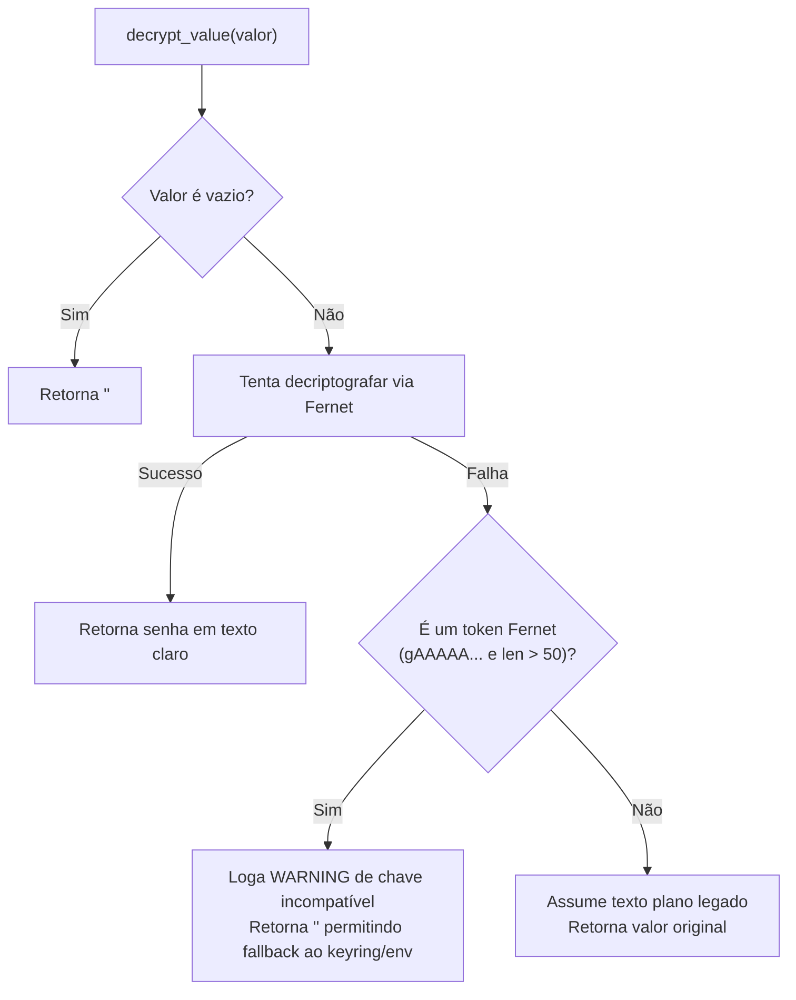

# Segurança, Criptografia e Cofre de Credenciais

> **Módulos:** [`src/crypto_utils.py`](../../src/crypto_utils.py) | [`src/auth.py`](../../src/auth.py) | [`src/services/evolution_client.py`](../../src/services/evolution_client.py) | [`src/services/sccm_service.py`](../../src/services/sccm_service.py)  
> **Testes Unitários:** [`tests/unit/test_crypto.py`](../../tests/unit/test_crypto.py) | [`tests/unit/test_security_hardening.py`](../../tests/unit/test_security_hardening.py)

---

## 🎯 1. Princípios de Segurança e Hardening (SecOps)

O Sistema Bancada STI manipula credenciais institucionais sensíveis (senhas de rede, acessos LDAP do Active Directory, credenciais do OTRS, CitSmart e banco de dados). 

Para garantir conformidade rigorosa com políticas de segurança da informação:
1. **Nenhuma senha em texto puro rastreada pelo Git:** Segredos foram expurgados de todos os scripts PowerShell (`bancada-launcher.ps1`, `sccm_sync.ps1`), arquivos de compose e testes. O `.gitignore` bloqueia ativamente `.env`, `.env.*`, `.secret.key`, `*.key`, `*.pem`, `cred_admin*.xml` e `sccm_inventory.json`.
2. **Arquitetura Fail-Closed Obrigatória:** Serviços, bancos e clientes de API NUNCA iniciam com credenciais default ou omitidas. Se `POSTGRES_PASSWORD`, `EVOLUTION_API_KEY` ou credenciais do SCCM estiverem vazias ou ausentes, a operação é bloqueada imediatamente.
3. **Isolamento de Portas e Serviços (127.0.0.1):** As portas de infraestrutura (PostgreSQL `5432` e Evolution API `8080`) são estritamente associadas a `127.0.0.1`, impedindo exposição em interfaces públicas ou de rede local.
4. **Proteção Anti-Brute-Force e Rate Limiting:** O sistema de login (`src/auth.py`) e o cofre de senhas (`src/tabs/senhas.py`) contam com bloqueio temporário (lockout) automático após 5 tentativas consecutivas incorretas (cooldown de 5 minutos).
5. **Mitigação Estrita de Injeções:**
   - **Command Injection:** Hostnames e nomes de usuário passam por validação estrita com Whitelist Regex (`^[a-zA-Z0-9][a-zA-Z0-9.\-_]{0,252}$`). Credenciais nunca são interpoladas em argumentos de linha de comando; são repassadas via variáveis de ambiente seguras (`env`).
   - **LDAP Injection:** Filtros do Active Directory utilizam `ldap3.utils.conv.escape_filter_chars` (RFC 4515).
   - **Path Traversal:** Resoluções de caminhos bloqueiam diretórios relativos com `..`.
6. **Proteção contra DoS e Zip-Bomb:** O download de arquivos e planilhas remotas (`src/scrapers/sharepoint_downloader.py`) possui limite rígido de 100 MB via streaming, com validação de assinatura PK (ZIP/OpenXML) e headers de tamanho.
7. **Permissões de Sistema de Arquivos (0600):** Arquivos de segredos (`.env`, `.secret.key`, `cred_admin.xml`) têm permissões restritas a `0600` (`-rw-------`) reforçadas automaticamente na inicialização (`00-iniciar.sh`, `init.py` e `src/config.py`).
8. **Proteções WebUI Streamlit:** Ativação forçada de proteção contra XSRF (`--server.enableXsrfProtection=true`), limite de upload a 50 MB, cookies com atributo `SameSite=Lax` e telemetria desativada.

---

## 🔑 2. Chave Mestra e Ciclo de Vida (`.secret.key`)

A chave criptográfica é gerada e mantida em `.secret.key` na raiz do projeto:
- Formato: Chave Base64 válida para uso na biblioteca `cryptography.fernet.Fernet`.
- Permissões no Linux/WSL: Protegida estritamente com `chmod 600 .secret.key`.
- Se o arquivo não existir em tempo de execução, o sistema tenta ler a variável de ambiente `BANCADA_FERNET_KEY` ou gera uma chave nova automaticamente.

---

## 🛡️ 3. Decriptografia com Fallback Gracioso

A função `decrypt_value()` implementa proteção de duplo estágio:



### Por que retornar string vazia em falhas de chave incompatível?
No ecossistema da Bancada, as credenciais são resolvidas sequencialmente:
```python
PASSWORD = decrypt_value(db_val) or keyring.get_password("servico", USERNAME) or env_val
```
Se `decrypt_value()` retornasse o próprio token cifrado (string corrompida de 100 caracteres) em vez de falhar graciosamente, o operador `or` assumiria que o token é a senha válida, quebrando a autenticação no OTRS/CitSmart. Retornando `""`, o sistema recorre de forma limpa ao keyring do Windows/Linux ou ao arquivo `.env` local.

---

## 👁️ 4. Mascaramento Visual para Interfaces (`mask_secret`)

Para exibição segura de segredos nas abas de configuração do Streamlit sem expor o conteúdo sensível:

```python
from src.crypto_utils import mask_secret

mascarado = mask_secret("MinhaSenhaForte2026", visible_chars=4)
# Retorno: "Minh••••••••2026"
```

Textos curtos (menores ou iguais ao dobro dos caracteres visíveis) são completamente mascarados com `•` para evitar vazamento de tamanho.

---

## 🔑 2. Chave Mestra e Ciclo de Vida (`.secret.key`)

A chave criptográfica é gerada e mantida em `.secret.key` na raiz do projeto:
- Formato: Chave Base64 válida para uso na biblioteca `cryptography.fernet.Fernet`.
- Permissões no Linux/WSL: Deve ser protegida com `chmod 600 .secret.key`.
- Se o arquivo não existir em tempo de execução, o sistema tenta ler a variável de ambiente `FERNET_KEY` ou gera uma chave nova automaticamente.

---

## 🛡️ 3. Decriptografia com Fallback Gracioso

A função `decrypt_value()` implementa proteção de duplo estágio:


### Por que retornar string vazia em falhas de chave incompatível?
No ecossistema da Bancada, as credenciais são resolvidas sequencialmente:
```python
PASSWORD = decrypt_value(db_val) or keyring.get_password("servico", USERNAME) or env_val
```
Se `decrypt_value()` retornasse o próprio token cifrado (string corrompida de 100 caracteres) em vez de falhar graciosamente, o operador `or` assumiria que o token é a senha válida, quebrando a autenticação no OTRS/CitSmart. Retornando `""`, o sistema recorre de forma limpa ao keyring do Windows/Linux ou ao arquivo `.env` local.

---

## 👁️ 4. Mascaramento Visual para Interfaces (`mask_secret`)

Para exibição segura de segredos nas abas de configuração do Streamlit sem expor o conteúdo sensível:

```python
from src.crypto_utils import mask_secret

mascarado = mask_secret("MinhaSenhaForte2026", visible_chars=4)
# Retorno: "Minh••••••••2026"
```

Textos curtos (menores ou iguais ao dobro dos caracteres visíveis) são completamente mascarados com `•` para evitar vazamento de tamanho.

