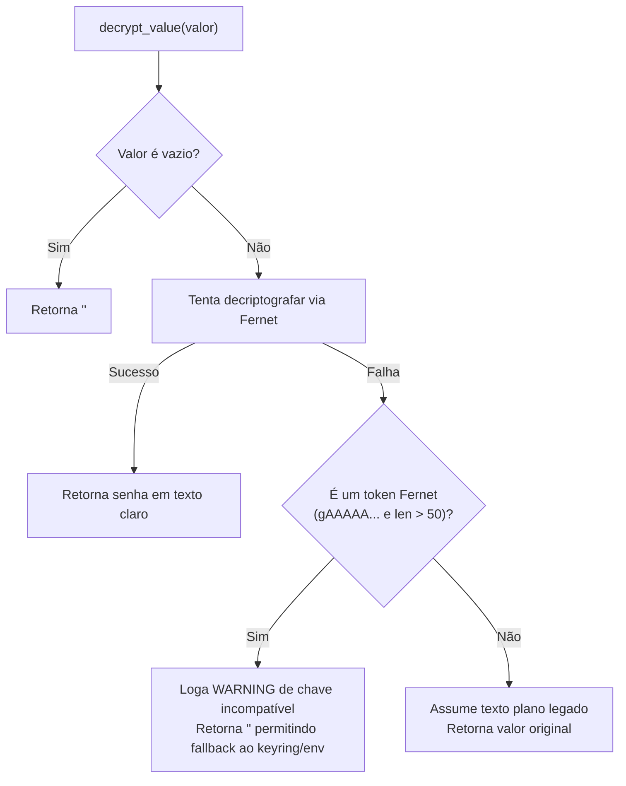

# Segurança, Criptografia e Cofre de Credenciais

> **Módulo:** [`src/crypto_utils.py`](../../src/crypto_utils.py)  
> **Testes Unitários:** [`tests/unit/test_crypto.py`](../../tests/unit/test_crypto.py)

---

## 🎯 1. Princípios de Segurança

O Sistema Bancada STI manipula credenciais institucionais sensíveis (senhas de rede, acessos LDAP do Active Directory, credenciais do OTRS, CitSmart e banco de dados). 

Para garantir conformidade com políticas de segurança da informação:
1. **Nenhuma senha em texto puro no repositório:** O arquivo `.env` não é versionado no Git (`.gitignore`), assim como arquivos de credenciais do PowerShell (`cred_admin.xml`).
2. **Criptografia Simétrica Fernet:** Qualquer senha gravada nas tabelas de configuração ou parâmetros de sistema é cifrada com chave de 256 bits.
3. **Resiliência a Troca de Ambiente:** Em migrações entre servidores ou máquinas de desenvolvimento, a falta ou incompatibilidade da chave mestra não trava a aplicação nem expõe tokens inválidos.

---

## 🔑 2. Chave Mestra e Ciclo de Vida (`.secret.key`)

A chave criptográfica é gerada e mantida em `.secret.key` na raiz do projeto:
- Formato: Chave Base64 válida para uso na biblioteca `cryptography.fernet.Fernet`.
- Permissões no Linux/WSL: Deve ser protegida com `chmod 600 .secret.key`.
- Se o arquivo não existir em tempo de execução, o sistema tenta ler a variável de ambiente `FERNET_KEY` ou gera uma chave nova automaticamente.

---

## 🛡️ 3. Decriptografia com Fallback Gracioso

A função `decrypt_value()` implementa proteção de duplo estágio:



### Por que retornar string vazia em falhas de chave incompatível?
No ecossistema da Bancada, as credenciais são resolvidas sequencialmente:
```python
PASSWORD = decrypt_value(db_val) or keyring.get_password("servico", USERNAME) or env_val
```
Se `decrypt_value()` retornasse o próprio token cifrado (string corrompida de 100 caracteres) em vez de falhar graciosamente, o operador `or` assumiria que o token é a senha válida, quebrando a autenticação no OTRS/CitSmart. Retornando `""`, o sistema recorre de forma limpa ao keyring do Windows/Linux ou ao arquivo `.env` local.

---

## 👁️ 4. Mascaramento Visual para Interfaces (`mask_secret`)

Para exibição segura de segredos nas abas de configuração do Streamlit sem expor o conteúdo sensível:

```python
from src.crypto_utils import mask_secret

mascarado = mask_secret("MinhaSenhaForte2026", visible_chars=4)
# Retorno: "Minh••••••••2026"
```

Textos curtos (menores ou iguais ao dobro dos caracteres visíveis) são completamente mascarados com `•` para evitar vazamento de tamanho.

