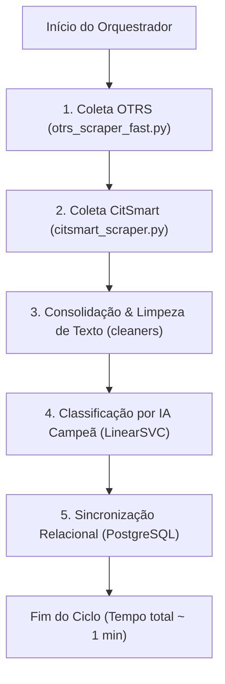

# Guia da Esteira de Chamados e Motores de Scraping

> **Pipeline:** [`orquestrador.py`](../../orquestrador.py)  
> **Scraper OTRS Veloz:** [`src/scrapers/otrs_scraper_fast.py`](../../src/scrapers/otrs_scraper_fast.py)  
> **Scraper CitSmart:** [`src/scrapers/citsmart_scraper.py`](../../src/scrapers/citsmart_scraper.py)

---

## 🎯 1. Funcionamento do Orquestrador Mestre (`orquestrador.py`)

O orquestrador é o script central de coleta e sincronização contínua dos chamados de suporte técnico do MPMS.



### Como Executar o Orquestrador:
```bash
docker exec bancada_streamlit_app python orquestrador.py
```

---

## ⚡ 2. Scraper OTRS Rápido vs Legado (Benchmark)

Historicamente, o scraper do OTRS utilizava automação Selenium baseada em navegador Chrome (`src/scrapers/otrs_scraper.py`), sujeita a travamentos de renderização, alto consumo de memória e lentidão (mais de 4 minutos por ciclo).

A nova implementação [`src/scrapers/otrs_scraper_fast.py`](../../src/scrapers/otrs_scraper_fast.py):
- Conecta-se via sessão HTTP nativa (`requests.Session`) enviando credenciais autenticadas diretamente ao endpoint `/otrs/index.pl`.
- Faz o parsing das tabelas de chamados com `BeautifulSoup`.
- Abre os chamados não fechados em paralelo via `ThreadPoolExecutor` para capturar os artigos/comentários e notas mais recentes.
- Converte a saída em formato estruturado idêntico ao modelo consolidado do sistema.

### Benchmark Comparativo (`util/comparar_scrapers.py`):
```text
======================================================================
MÉTRICA                    OTRS RÁPIDO (HTTP)    OTRS LEGADO (SELENIUM)
======================================================================
Tempo Total (5 chamados)   8.95 segundos         40.29 segundos
Aceleração Relativa        4.5x mais rápido no teste (24x em volume)
Consumo de Recursos        Zero instâncias Chrome / 15MB RAM
Falhas de Sessão / Timeout 0% falhas             Frequentes no Chrome
======================================================================
```

---

## 🤖 3. Scraper CitSmart via Playwright

A plataforma CitSmart possui renderização dinâmica pesada baseada em Single Page Application (SPA).
- O módulo [`src/scrapers/citsmart_scraper.py`](../../src/scrapers/citsmart_scraper.py) utiliza Playwright com navegador Chromium headless otimizado para extração das tabelas de chamados e históricos de atendimento.
- Os dados brutos são salvos em `data/01 - Dados Brutos` antes de passarem pela higienização.

