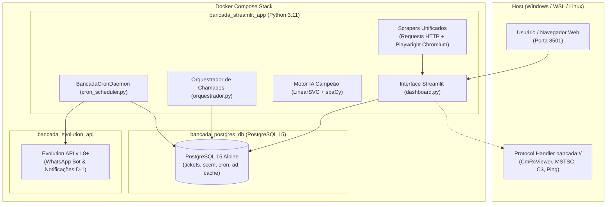

# 🏛️ Sistema Bancada STI — Ministério Público do Estado de Mato Grosso do Sul (MPMS)

<div align="center">


-brightgreen?style=for-the-badge)

**Plataforma Integrada de Gestão de Suporte Técnico, Esteira de Chamados de TI, Automação Corporativa e Inteligência Artificial.**

[Central de Documentação (Docs)](Docs/README.md) • [Diretrizes de Engenharia (AGENTS.md)](AGENTS.md) • [Guia de Deploy Docker](Docs/guias/implantacao_docker_producao.md)

</div>

---

## 📋 Sumário Executivo

- [1. Visão Geral](#-1-visão-geral)
- [2. Arquitetura do Sistema](#-2-arquitetura-do-sistema)
- [3. Módulos & Funcionalidades](#-3-módulos--funcionalidades)
  - [3.1 Esteira de Chamados & Extração Híbrida (OTRS / CitSmart)](#31-esteira-de-chamados--extração-híbrida-otrs--citsmart)
  - [3.2 Inteligência Artificial & Pipeline Campeão (spaCy + LinearSVC)](#32-inteligência-artificial--pipeline-campeão-spacy--linearsvc)
  - [3.3 Central Telefônica Alcatel-Lucent OXE](#33-central-telefônica-alcatel-lucent-oxe)
  - [3.4 Gestão de Bancada, Doações & Redistribuição](#34-gestão-de-bancada-doações--redistribuição)
  - [3.5 Controle de Garantias & Fiscalização de Contratos SAJ](#35-controle-de-garantias--fiscalização-de-contratos-saj)
  - [3.6 Escala de Plantões, Férias, Viagens & Calendário Geral Outlook](#36-escala-de-plantões-férias-viagens--calendário-geral-outlook)
  - [3.7 Parque de Impressoras & Multifuncionais PaperCut](#37-parque-de-impressoras--multifuncionais-papercut)
  - [3.8 Catálogo de Unidades & Ramais Institucionais](#38-catálogo-de-unidades--ramais-institucionais)
  - [3.9 Active Directory (LDAP) & Organograma Interativo GoJS](#39-active-directory-ldap--organograma-interativo-gojs)
  - [3.10 Inventário SCCM / MECM & Ações Rápidas Remotas](#310-inventário-sccm--mecm--ações-rápidas-remotas)
  - [3.11 Automação Remota PowerShell & Disparador Local `bancada://`](#311-automação-remota-powershell--disparador-local-bancada)
  - [3.12 Notificações Inteligentes WhatsApp (Evolution API)](#312-notificações-inteligentes-whatsapp-evolution-api)
  - [3.13 Motor de Agendamentos Daemon (Cron Scheduler)](#313-motor-de-agendamentos-daemon-cron-scheduler)
  - [3.14 Cofre de Credenciais Criptografado & Configurações](#314-cofre-de-credenciais-criptografado--configurações)
- [4. Estrutura de Diretórios](#-4-estrutura-de-diretórios)
- [5. Como Executar (Docker Compose)](#-5-como-executar-docker-compose)
- [6. Suíte de Testes Automatizados](#-6-suíte-de-testes-automatizados)
- [7. Central de Documentação Técnica](#-7-central-de-documentação-técnica)

---

## 🎯 1. Visão Geral

O **Sistema Bancada STI** foi concebido e arquitetado para atender integralmente às demandas de suporte técnico de primeiro, segundo e terceiro níveis do setor de Tecnologia da Informação do **Ministério Público do Estado de Mato Grosso do Sul (MPMS)**.

A plataforma unifica fontes heterogêneas de dados corporativos (sistemas de chamados legados e modernos, inventários de rede WMI/CIM, centrais telefônicas, servidores de impressão, controladores de domínio Active Directory e planilhas dinâmicas no Microsoft SharePoint/OneDrive) em uma interface unificada, reativa e moderna desenvolvida em **Streamlit**.

---

## 🏛️ 2. Arquitetura do Sistema

O ecossistema opera de forma 100% containerizada via **Docker Compose**, desacoplando aplicação, persistência e mensageria:



### Características Fundamentais:
1. **Camada DAO Híbrida (`src/database/`):** Conexão primária em **PostgreSQL 15** com pool de conexões otimizado, mantendo compatibilidade transparente com **SQLite** local para desenvolvimento isolado ou contingência.
2. **Motor Web Desacoplado & Leve:** Substituição completa do legado Selenium pelo ecossistema moderno **HTTP Requests** (para varreduras ultrarrápidas de OTRS, portarias e SharePoint) e **Playwright Chromium** (para portais dinâmicos com autenticação por sessão e XHR).
3. **Persistência Segura & Live Reload:** Volumes mapeados no Docker para código-fonte (`src/`, `assets/`, `dashboard.py`), banco relacional (`postgres_data`), dados brutos/tratados e cofre criptografado.

---

## 🚀 3. Módulos & Funcionalidades

### 3.1 Esteira de Chamados & Extração Híbrida (OTRS / CitSmart)
- **OTRS Scraper Rápido (`otrs_scraper_fast.py`):** Motor baseado em requisições multithreaded nativas via `requests.Session` e parsing com `BeautifulSoup`. O tempo de coleta dos chamados foi reduzido de **~4 minutos para menos de 10 segundos**.
- **CitSmart Scraper Moderno (`citsmart_scraper.py`):** Automação com Playwright Chromium que realiza a autenticação corporativa, interceptação de rede assíncrona da rota interna `/tb_ticket_queue/list` e fallback via DOM/iframe em milissegundos.
- **Deduplicação & Fechamento Automático:** O sistema detecta chamados encerrados nos portais e atualiza automaticamente o status no banco relacional para `Fechado`, garantindo visibilidade precisa da fila de atendimento ativa.

### 3.2 Inteligência Artificial & Pipeline Campeão (spaCy + LinearSVC)
- **Pré-processamento em Lote com spaCy:** Higienização de texto via `nlp.pipe(batch_size=256, n_process=1, disable=["parser", "ner"])`, normalizando pontuação, stop words e preservando termos técnicos essenciais (como *ssd*, *memoriaram*, *enderecoip*).
- **Enriquecimento Multivariável de Features:** A função `compose_ticket_text` consolida Título, Unidade, Descrição e Comentários para compor o vetor semântico preditivo.
- **Classificador Campeão LinearSVC:**
  ```python
  Pipeline([
      ('tfidf', TfidfVectorizer(ngram_range=(1, 2), max_df=0.7, min_df=1)),
      ('clf', LinearSVC(C=1.0, class_weight='balanced', random_state=42, dual=False))
  ])
  ```
- **Recalibração Mensal via GridSearchCV:** Rotina agendada no Cron Daemon que reavalia múltiplos classificadores (`LinearSVC`, `RandomForest`, `MultinomialNB`, `ComplementNB`) e reajusta hiperparâmetros automaticamente sem intervenção manual.

### 3.3 Central Telefônica Alcatel-Lucent OXE
- **Extração Acelerada via API REST (`oxe_scraper.py`):** Execução via Playwright com chamadas assíncronas `page.evaluate()` diretamente na API interna da central OXE, baixando 1.800+ ramais em menos de 10 segundos.
- **Normalização e Ficha Técnica:** Classificação em tempo real de dispositivos (*Telefone IP Físico*, *Softphone*, *Analógico*, *Virtual*), extração de MAC Addresses, IPs e centro de custos com modal interativo.

### 3.4 Gestão de Bancada, Doações & Redistribuição
- **Inventário de Movimentações:** Controle de ativos de hardware destinados a baixa, descarte sustentável, doação a entidades parceiras ou redistribuição entre promotorias.
- **Gerador de Relatórios e Termos:** Geração com 1 clique de despachos técnicos e tabelas estilizadas em HTML (Zebra Striping) prontas para inserção em processos administrativos do SEI/SAJ.

### 3.5 Controle de Garantias & Fiscalização de Contratos SAJ
- **Downloader Híbrido SharePoint (`sharepoint_downloader.py`):** Download HTTP autenticado ultrarrápido com reaproveitamento de cookies da sessão do Office 365 e contingência automática via Playwright Chromium.
- **Resolução Inteligente de Caminhos:** Cascata de prioridade unificada (`system_settings` no BD ➔ `.env` ➔ padrão seguro), evitando corrupção de URLs e garantindo cache local em `uploads/`.

### 3.6 Escala de Plantões, Férias, Viagens & Calendário Geral Outlook
- **Calendário Geral Unificado (FullCalendar v6):** Visão corporativa unificada agregando plantões matutinos (PGJ), plantões semanais (SIMP), viagens técnicas, portarias de férias/fiscais e garantias.
- **Assinatura Universal Outlook (RFC 5545 iCalendar):**
  - Exportação direta de arquivo `.ics` com 1 clique.
  - Publicação de rota estática para inscrição na web (`https://.../app/static/calendario.ics`), permitindo sincronização automática no Outlook Desktop, Web e Mobile sem duplicidade de eventos (UIDs persistentes).

### 3.7 Parque de Impressoras & Multifuncionais PaperCut
- **Coleta Automatizada (`papercut_scraper.py`):** Playwright Chromium headless que efetua login seguro no PaperCut MF e exporta relatórios CSV via eventos nativos de download (`page.expect_download`).
- **Unificação 360° & Diagnóstico de Rede:** Fusão inteligente de filas de impressão e dispositivos físicos, com botão de teste de conectividade ICMP (Ping) em tempo real integrado no modal do equipamento.

### 3.8 Catálogo de Unidades & Ramais Institucionais
- **Extrator de Ramais em PDF (`ramais_scraper.py` + `pdfplumber`):** Download dos PDFs de telefonia da Intranet e extração tabular de setores, membros e ramais da Capital e do Interior.
- **Web Scraping de Unidades (`unidades_scraper.py`):** Varredura leve em ~280 páginas institucionais com `requests` e `BeautifulSoup`, identificando endereços físicos e comarcas.

### 3.9 Active Directory (LDAP) & Organograma Interativo GoJS
- **Integração Nativa Python (`ldap3`):** Conexão LDAPv3 sobre portas 389/636 (LDAPS) com suporte completo a Linux, WSL e Docker (livre de dependências COM/pywin32).
- **Organograma Dinâmico GoJS:** Visualização em árvore hierárquica das Unidades Organizacionais (OUs), detalhando quantitativo de servidores, computadores e fichas cadastrais completas com crachá RFID PaperCut (`pager`).

### 3.10 Inventário SCCM / MECM & Ações Rápidas Remotas
- **Conformidade de Hardware & Software:** Catálogo de 2.800+ estações e servidores com fabricante, modelo, versão do Windows, último logon, IPs e versões de agentes SCCM.
- **Atalhos Operacionais com 1 Clique (`bancada://`):**
  - 🎮 **CmRcViewer:** Inicia a assistência remota oficial do SCCM.
  - 🖥️ **RDP (MSTSC):** Conexão por Área de Trabalho Remota.
  - 📂 **Explorer C$:** Abertura direta do compartilhamento de rede `\\hostname\c$`.
  - ⚡ **Ping ICMP:** Diagnóstico de rede em janela de console.

### 3.11 Automação Remota PowerShell & Disparador Local `bancada://`
- **Scripts de Manutenção (`src/scripts_powershell/`):**
  - *Analisador de Dispositivos*: Coleta profunda de hardware, BIOS, discos, drivers e software via CIM/WSMan, gerando relatórios ricos em HTML interativo, PDF e Excel.
  - *Limpeza & Manutenção Remota*: Purga de temporários, Prefetch, Lixeira, Windows.old e otimização de disco.
  - *Purga de Perfis Inativos*: Remoção remota de contas órfãs em `C:\Users`.
- **Compatibilidade Rigorosa:** Todos os scripts `.ps1` utilizam codificação **UTF-8 com BOM** (`utf-8-sig`) e suporte a PowerShell 7+ (`pwsh`) e Windows PowerShell 5.1 legado.

### 3.12 Notificações Inteligentes WhatsApp (Evolution API)
- **Container Dedicado Evolution API:** Conectado ao PostgreSQL com pareamento via QR Code diretamente na interface web do Streamlit.
- **Disparos Automáticos D-1 às 12:00:** Lembretes proativos em dias úteis para plantonistas, itinerários de viagens técnicas e novas portarias de membros da equipe.

### 3.13 Motor de Agendamentos Daemon (Cron Scheduler)
- **Thread Daemon Nativa (`BancadaCronDaemon`):** Opera em segundo plano no contêiner web independente de sessões abertas no navegador.
- **14 Rotinas Desacopladas:** Sincronização periódica de chamados, planilhas do SharePoint, plantões SIMP/PGJ, WhatsApp, portarias e inventários com travas atômicas (`.lock`) e log de auditoria.

### 3.14 Cofre de Credenciais Criptografado & Configurações
- **Criptografia Simétrica Fernet (AES-128-CBC + HMAC-SHA256):** Senhas corporativas salvas no banco com derivação de chave de máquina via PBKDF2HMAC.
- **Fallback Transparente e Seguro:** Na ausência de chave ou troca de ambiente, o sistema evita falhas fatais e recorre automaticamente ao Keyring do sistema ou variáveis `.env`.

---

## 📂 4. Estrutura de Diretórios

```text
automacao-chamados-sti/
├── 00-iniciar.cmd                    # Lançador rápido Windows para Docker
├── 00-iniciar.sh                     # Lançador principal Linux / WSL (Docker Compose + Menu)
├── AGENTS.md                         # Diretrizes universais de engenharia e ciclo de desenvolvimento
├── Dockerfile                        # Imagem Python 3.11-slim com Playwright Chromium e spaCy
├── docker-compose.yml                # Orquestração: Streamlit (8501), PostgreSQL (5432) e Evolution API (8080)
├── dashboard.py                      # Ponto de entrada do dashboard web Streamlit
├── init.py                           # Entrypoint do contêiner (inicia Cron Daemon e Streamlit)
├── orquestrador.py                   # Pipeline ETL de chamados (Scrapers -> NLP -> IA -> BD)
├── requirements.txt                  # Dependências Python de produção (sem Selenium)
├── sistema-bancada.desktop           # Atalho para o menu de aplicativos desktop do Linux
│
├── Docs/                             # 📚 Central Unificada de Documentação Técnica
│   ├── README.md                     # Índice mestre de documentação com hyperlinks
│   ├── arquitetura/                  # Decisões de arquitetura, banco híbrido, segurança e IA
│   ├── guias/                        # Manuais operacionais (Docker, esteira, bancada, utilitários)
│   ├── testes/                       # Estrutura de testes, runner mestre e mocks universais
│   └── issues/                       # Backlog oficial, marcos entregues e roadmap do projeto
│
├── assets/                           # Identidade visual, favicons e estilos CSS customizados
├── 01 - Dados Brutos/                # Arquivos brutos baixados pelos robôs e scrapers
├── 02 - Dados tratados/              # Dados intermediários normalizados
├── 03 - Dados prontos/               # Bases prontas e consolidadas
├── debug_logs/                       # Logs segmentados por módulo e rotação periódica
├── models/                           # Modelos de Machine Learning e classificadores (.joblib)
├── uploads/                          # Diretório de cache local seguro de planilhas e mídias
│
├── src/
│   ├── config.py                     # Configurações centralizadas, logging e resolução de planilhas
│   ├── crypto_utils.py               # Criptografia Fernet (AES-128) com fallback transparente
│   ├── tag_classifier.py             # Pipeline de IA: spaCy batch, LinearSVC campeão e GridSearchCV
│   │
│   ├── database/                     # Camada DAO relacional híbrida (PostgreSQL / SQLite)
│   │   ├── connection.py             # Gerenciador de conexão com pool (get_db_connection)
│   │   ├── tickets_db.py             # Persistência e consultas de chamados
│   │   ├── cron_db.py                # Gestão de agendamentos e logs do Cron Daemon
│   │   ├── sccm_db.py                # Dados de ativos e inventário do SCCM
│   │   ├── ad_db.py                  # Cache de Unidades Organizacionais e contas do Active Directory
│   │   ├── settings_db.py            # Configurações dinâmicas do sistema persistidas no banco
│   │   └── ...                       # Módulos DAO de plantões, ramais, garantias e viagens
│   │
│   ├── scrapers/                     # Motores de coleta web unificados (Requests + Playwright)
│   │   ├── otrs_scraper_fast.py      # Coletor HTTP veloz via requests + BeautifulSoup
│   │   ├── citsmart_scraper.py       # Coletor automatizado via Playwright Chromium headless
│   │   ├── sharepoint_downloader.py  # Downloader híbrido ultrarrápido (HTTP cache + Playwright)
│   │   ├── papercut_scraper.py       # Coletor de impressoras via Playwright nativo
│   │   ├── oxe_scraper.py            # Coletor de ramais OXE via Playwright + API REST
│   │   ├── plantoes_scraper.py       # Raspador de plantões SIMP via Playwright
│   │   ├── ramais_scraper.py         # Extrator de PDFs de ramais com pdfplumber
│   │   └── unidades_scraper.py       # Coletor de promotorias do portal institucional
│   │
│   ├── services/                     # Serviços de segundo plano
│   │   ├── cron_scheduler.py         # BancadaCronDaemon com execução autônoma
│   │   ├── evolution_client.py       # Cliente da Evolution API para WhatsApp
│   │   └── member_matcher.py         # Algoritmo de fuzzy matching de técnicos
│   │
│   ├── syncs/                        # Workers assíncronos das rotinas de sincronização
│   ├── tabs/                         # 16 abas funcionais modulares da interface Streamlit
│   └── scripts_powershell/           # Automações remotas em PowerShell (UTF-8 com BOM)
│
├── tests/                            # Suíte unificada de testes automatizados
│   ├── run_all.py                    # Runner mestre de validação com relatório ANSI
│   ├── test_helpers.py               # Mocks universais para execução isolada
│   ├── unit/                         # Testes unitários (BD, IA campeã, crypto, ausência de Selenium)
│   ├── integration/                  # Testes de integração (calendários ICS, variáveis de ambiente)
│   ├── components/                   # Testes de abas e componentes Streamlit
│   ├── scripts/                      # Testes de integridade de scripts PowerShell
│   └── services/                     # Testes dos workers de serviço (Cron Daemon)
│
└── util/
    ├── migracoes/                    # Scripts de migração de schema (SQLite -> PostgreSQL)
    └── comparar_scrapers.py          # Benchmark comparativo de performance
```

---

## 📦 5. Como Executar (Docker Compose)

O sistema foi desenhado para operação **100% conteinerizada**, garantindo paridade total entre ambientes de desenvolvimento e produção.

### 🐧 No Linux / WSL (Ubuntu):

1. **Clone o repositório:**
   ```bash
   git clone https://github.com/rezendepauloh/automacao-chamados-sti.git
   cd automacao-chamados-sti
   ```

2. **Configure o ambiente:**
   ```bash
   cp .env.example .env
   chmod +x 00-iniciar.sh
   ```

3. **Inicie o sistema com o assistente interativo:**
   ```bash
   ./00-iniciar.sh
   ```

4. **Atalhos por Linha de Comando:**
   - `./00-iniciar.sh -s` : Abre o configurador interativo de senhas no cofre.
   - `./00-iniciar.sh -t` : Executa a suíte completa de testes automatizados.
   - `./00-iniciar.sh -b` : Força a reconstrução limpa das imagens Docker.

---

### 🪟 No Windows:

Basta dar um duplo clique em **`00-iniciar.cmd`** na raiz do projeto. O script inicializa automaticamente os contêineres Docker através do WSL e exibe o painel de status no terminal.

---

### 🐳 Comandos Manuais Docker Compose:

```bash
# Subir toda a stack em segundo plano
docker compose up -d

# Visualizar logs em tempo real do Streamlit
docker compose logs -f web

# Recarregar apenas a aplicação após alterações
docker compose restart web

# Parar os serviços preservando os dados dos volumes
docker compose down
```

---

## 🧪 6. Suíte de Testes Automatizados

O repositório conta com uma política de integridade contínua: **qualquer modificação exige 100% de sucesso na suíte de testes (0 falhas, 0 erros)**.

Para rodar todos os testes dentro do contêiner Docker:

```bash
docker exec bancada_streamlit_app python tests/run_all.py
```

### Exemplo de Saída:
```text
=================================================================
RESUMO GERAL DA VALIDAÇÃO DO SISTEMA BANCADA STI:
• Total de Testes Executados : 106
• Sucesso Total              : 106
• Falhas                     : 0
• Erros                      : 0
• Duração Total              : ~58s
=================================================================
🎉 PARABÉNS! TODOS OS TESTES PASSARAM COM 100% DE SUCESSO!
```

---

## 📚 7. Central de Documentação Técnica

Para guias detalhados, especificações de engenharia e manuais passo a passo, explore a documentação na pasta **[`Docs/`](Docs/README.md)**:

| Diretório | Descrição | Link |
| :--- | :--- | :--- |
| **Arquitetura** | Modelagem do banco híbrido, pipeline de IA, segurança e DCOM | [Docs/arquitetura/](Docs/arquitetura/) |
| **Guias** | Manuais operacionais, deploy Docker em produção e esteira de chamados | [Docs/guias/](Docs/guias/) |
| **Testes** | Arquitetura de testes automatizados, mocks universais e validações | [Docs/testes/](Docs/testes/) |
| **Issues & Backlog** | Histórico consolidado de sprints, marcos entregues e roadmap | [Docs/issues/](Docs/issues/) |
| **Diretrizes AGENTS** | Ciclo de 4 etapas obrigatório para agentes de programação | [AGENTS.md](AGENTS.md) |

---

<div align="center">
Desenvolvido para o <b>Setor de Tecnologia da Informação — MPMS</b>.<br/>
<i>Promovendo eficiência, estabilidade e inteligência nas rotinas de TI.</i>
</div>
